# 🤖 Awesome Agent Operating Systems & AI Runtime Frameworks

  

    

  <strong>A curated landscape of Agentic Operating Systems, Multi-Agent Orchestration Runtimes, Stateful LLM Memory Kernels &amp; Isolated Sandboxes</strong>

---

## 🔍 SEO & Technology Keywords
`Agent Operating System` • `AI Runtime Frameworks` • `Multi-Agent Orchestration` • `LLM Operating System` • `Autonomous AI Agents` • `Stateful AI Runtimes` • `Model Context Protocol (MCP)` • `Persistent Memory Kernels` • `Docker MicroVM Sandboxes` • `Local LLM Agent Runtimes` • `Cyclic Agent Graphs` • `Enterprise AI Workflow Automation`

---

## 📖 Table of Contents
- [🌐 Sector Overview & Market Dynamics](#-sector-overview--market-dynamics)
- [☁️ SaaS & Hosted Platforms](#️-saas--hosted-platforms)
- [⚡ Open-Source GitHub Projects](#-open-source-github-projects)
- [🛠️ Recommended Architecture Stacks](#️-recommended-architecture-stacks)
- [🤝 How to Contribute](#-how-to-contribute)
- [💖 Support](#-support)
- [📈 Star History](#-star-history)
- [📜 Disclaimer](#-disclaimer)

---

## 🌐 Sector Overview & Market Dynamics

The global Autonomous AI Agents and Agentic Runtime market is estimated between **$5.8B and $11.5B in 2026** (projected to surge at a **38%–50% CAGR** through the early 2030s). The sector exhibits **medium concentration with high architectural fragmentation**: while foundational LLM reasoning layers remain concentrated among a few frontier model labs, the agent orchestration, memory, runtime OS, and tool-calling framework layers remain highly fragmented across innovative startups and rapid open-source ecosystems rather than a winner-take-all monopoly.

---

## ☁️ SaaS & Hosted Platforms

| 🏢 Platform | 💰 Company Valuation / Size | 🏷️ Starting Tier Pricing | 🎁 Free Tier / Trial Limits | 📝 Description |
| :--- | :--- | :--- | :--- | :--- |
| **[LangGraph Platform (LangSmith Deployment)](https://langchain.com)** | **$3.0B valuation** ($460M raised) | **$39 / seat / month** (Plus Plan; metered overages for high-volume traces/runs) | **Free forever Developer Tier**: 1 seat, up to 5,000 base traces/month | Managed infrastructure for deploying, scaling, and debugging stateful, cyclic agent graphs with built-in persistence and human-in-the-loop controls. |
| **[Dify Cloud](https://dify.ai)** | **$180M valuation** ($30M raised) | **$59 / month** (Professional Plan; or $159/month Team Plan) | **Free forever Sandbox Plan**: 1 member, 200 one-time message credits, 10 apps, 50MB vector storage, 30-day logs | Hosted LLM application and agentic workflow platform combining RAG pipelines, visual agent orchestration, model management, and observability. |
| **[CrewAI Enterprise](https://crewai.com)** | **~$100M–$177M valuation** ($18M raised) | **Custom enterprise pricing** (self-serve/starter custom quotes for enterprise governance) | **Free forever Basic Plan**: 50 workflow executions/month, 2 automations, visual Studio editor, GitHub integration | Cloud-hosted multi-agent orchestration suite featuring visual workflow builders, RBAC, real-time tracing, and managed production deployments. |
| **[Botpress Cloud](https://botpress.com)** | **$120M valuation** ($45M raised) | **$150 / month billed annually** ($189/mo monthly for Plus Plan) | **Free forever Plan**: 100 incoming conversations/month, 3 seats, 3 AI agents, community support | Enterprise conversational AI and autonomous agent studio offering visual flow building, knowledge base syncing, and omnichannel deployment. |
| **[Letta Cloud](https://letta.com)** | **$70M valuation** ($10M raised) | **$20 / month** (Pro Tier with matching monthly model/sandbox credits) | **Free forever Tier**: 3 stateful agents, bring-your-own API keys (BYOK), perpetual memory storage | Hosted stateful agent runtime built around MemGPT principles for long-term memory management, perpetual learning, and multi-session context. |
| **[Stack AI](https://stack-ai.com)** | **~$64M valuation** ($19M raised; acquired by Asana) | **Custom enterprise pricing** (post-acquisition custom contracts; historically $199/mo Starter) | **Free forever Plan**: 500 workflow runs/month, 2 active projects, 1 seat, Discord support | No-code enterprise AI workflow and agent automation platform with SOC2/HIPAA compliance and pre-built connectors for business tools. |
| **[Fixie.ai](https://fixie.ai)** | **~$51.5M valuation** ($17M raised; acquired by Inworld AI) | **$0.05 / minute** (Pay As You Go voice runtime) | **Free forever Tier**: 30 free minutes, 5 concurrent calls, unlimited playground testing | Cloud runtime and developer platform (Ultravox) focused on real-time voice-enabled and conversational AI agents with external API integration. |
| **[Flowise Cloud](https://flowiseai.com)** | **Undisclosed valuation** (backed by YC, acquired by Workday) | **$35 / month** (Starter Plan; or $65/month Pro Plan) | **Free forever Plan**: 100 predictions/month, 2 active flows/assistants, 5MB storage | Managed visual drag-and-drop platform for building, testing, and deploying multi-agent systems and LLM chains via APIs and widgets. |
| **[SuperAGI Cloud](https://superagi.com)** | **<$100M valuation** (~$15M raised) | **$49 / user / month** (Starter Cloud / AI SDR outreach tier) | **Free forever Tier**: 100 free credits/month for agent testing and prospecting exploration | Cloud-based autonomous AI agent platform enabling concurrent agent execution, marketplace toolkits, and performance telemetry. |

---

## ⚡ Open-Source GitHub Projects

*Sorted descending by GitHub stargazer count. Stars_Badges beside each repository link directly to its stargazers page.*

- 🌟 **[AutoGPT](https://github.com/Significant-Gravitas/AutoGPT)**   
  Autonomous general-purpose AI agent architecture recursively chaining LLM thoughts, web search, and workspace operations.

- 🌟 **[Ollama](https://github.com/ollama/ollama)**   
  Lightweight, scalable runtime to run, customize, and serve local open-source LLMs (Llama, DeepSeek, Mistral) for sovereign agent stacks.

- 🌟 **[Dify](https://github.com/langgenius/dify)**   
  Production-ready open-source LLMOps and multi-agent workflow platform combining RAG pipelines, visual prompt orchestration, and routing.

- 🌟 **[Browser-Use](https://github.com/browser-use/browser-use)**   
  Autonomous web agent runtime enabling LLMs to navigate websites, click elements, fill forms, and extract web data via Playwright.

- 🌟 **[OpenHands (formerly OpenDevin)](https://github.com/All-Hands-AI/OpenHands)**   
  Open-source platform for autonomous software development agents equipped with sandboxed Docker, bash, code editor, and browser tools.

- 🌟 **[Model Context Protocol (MCP) Servers](https://github.com/modelcontextprotocol/servers)**   
  Anthropic's open standard and server implementations for connecting AI agents securely to tools, filesystems, and databases.

- 🌟 **[MetaGPT](https://github.com/geekan/MetaGPT)**   
  Multi-agent meta-programming framework assigning Standard Operating Procedures (SOPs) to simulated software company roles (PM, architect, engineer).

- 🌟 **[Mem0](https://github.com/mem0ai/mem0)**   
  Universal personalized memory engine for AI agents providing stateful, long-term multi-session user and entity context retention.

- 🌟 **[Open Interpreter](https://github.com/openinterpreter/openinterpreter)**   
  Open-source natural language interface for computers that executes Python, JavaScript, and shell commands locally in sandboxes.

- 🌟 **[LiteLLM](https://github.com/BerriAI/litellm)**   
  High-throughput LLM gateway and routing proxy providing unified OpenAI-compatible formatting, load balancing, and failover across 100+ LLMs.

- 🌟 **[Microsoft AutoGen & AutoGen Studio](https://github.com/microsoft/autogen)**   
  Multi-agent conversation framework facilitating complex collaborative workflows with event-driven agents and human-in-the-loop support.

- 🌟 **[CrewAI](https://github.com/crewAIInc/crewAI)**   
  Production multi-agent orchestration framework enabling role-playing autonomous AI agents to collaborate seamlessly on complex tasks.

- 🌟 **[Flowise](https://github.com/FlowiseAI/Flowise)**   
  Low-code drag-and-drop visual interface for orchestrating LLM flows, multi-agent systems, memory layers, and custom tool integrations.

- 🌟 **[LlamaIndex Workflows](https://github.com/run-llama/llama_index)**   
  Data framework and event-driven workflow engine for building context-augmented, multi-agent RAG pipelines and knowledge systems.

- 🌟 **[LangGraph](https://github.com/langchain-ai/langgraph)**   
  Stateful orchestration engine for cyclic, multi-actor agent workflows with fine-grained persistence, streaming, and time-travel debugging.

- 🌟 **[Agno (formerly Phidata)](https://github.com/agno-agi/agno)**   
  High-performance multi-modal agent framework with built-in memory, persistent knowledge bases, and ultra-fast Python execution.

- 🌟 **[Langfuse](https://github.com/langfuse/langfuse)**   
  Open-source LLM observability, prompt management, and agent evaluation suite with OpenTelemetry distributed tracing.

- 🌟 **[OpenAI Agents SDK](https://github.com/openai/openai-agents-python)**   
  Lightweight open-source Python runtime for multi-agent handoffs, guardrails, session state, and built-in tracing.

- 🌟 **[Smolagents (Hugging Face)](https://github.com/huggingface/smolagents)**   
  Minimalist Python agent library centered on code-executing agents that write and evaluate programmatic actions directly.

- 🌟 **[Mastra](https://github.com/mastra-ai/mastra)**   
  Full-stack TypeScript framework for building modern AI agents with integrated workflow pipelines, evaluations, and memory stores.

- 🌟 **[Microsoft Semantic Kernel](https://github.com/microsoft/semantic-kernel)**   
  Enterprise lightweight SDK enabling seamless integration of LLMs, agent planners, plugins, and vector memories across C#, Python, and Java.

- 🌟 **[Haystack](https://github.com/deepset-ai/haystack)**   
  Modular open-source framework for building customizable LLM pipelines, autonomous agent tool chains, and production search applications.

- 🌟 **[Letta (formerly MemGPT)](https://github.com/letta-ai/letta)**   
  Stateful Agent Operating System providing LLMs with hierarchical self-editing memory, persistent storage, and background agent execution.

- 🌟 **[Google Agent Development Kit (ADK)](https://github.com/google/adk-python)**   
  Code-first open-source toolkit for developing, evaluating, and deploying modular multi-agent hierarchies with bidirectional streaming.

- 🌟 **[Pydantic AI](https://github.com/pydantic/pydantic-ai)**   
  Type-safe agent framework engineered by Pydantic for robust structured outputs, dependency injection, and model-agnostic runtimes.

- 🌟 **[SWE-agent](https://github.com/princeton-nlp/SWE-agent)**   
  Agent framework turning LLMs into software engineers via specialized Agent-Computer Interfaces (ACI) to resolve GitHub issues end-to-end.

- 🌟 **[ElizaOS (ai16z)](https://github.com/elizaOS/eliza)**   
  Modular TypeScript multi-agent operating system designed for autonomous characters, social platform autonomous interactions, and plugin scaling.

- 🌟 **[CAMEL-AI](https://github.com/camel-ai/camel)**   
  Pioneering communicative multi-agent framework dedicated to studying cooperative autonomous agent behavior and synthetic data generation.

- 🌟 **[SuperAGI](https://github.com/TransformerOptimus/SuperAGI)**   
  Dev-first autonomous AI agent framework supporting concurrent agent loops, marketplace toolkits, and graphical execution tracking.

- 🌟 **[Botpress](https://github.com/botpress/botpress)**   
  Developer-centric open-source conversational AI platform and runtime for building autonomous bots and workflow agents.

- 🌟 **[E2B Code Interpreter](https://github.com/e2b-dev/E2B)**   
  Secure cloud sandbox infrastructure built for AI agents to safely execute code, inspect files, and run interactive shell environments.

- 🌟 **[Arize Phoenix](https://github.com/Arize-ai/phoenix)**   
  AI observability and evaluation platform for tracing agent execution, visualizing tool calls, and benchmarking retrieval performance.

- 🌟 **[AIOS (LLM Agent OS)](https://github.com/agiresearch/AIOS)**   
  Kernel-level Agent Operating System optimizing LLM scheduling, memory context switching, and isolated tool execution.

- 🌟 **[Zep](https://github.com/getzep/zep)**   
  Fast, scalable long-term memory server for AI agents and assistants providing temporal fact extraction and semantic search over conversation histories.

- 🌟 **[AgenticOS](https://github.com/vstorm-co/agenticos)**   
  Open-source Agent Operating System built on Pydantic AI with Unix-style virtual filesystem, permission boundaries, and modular skill packs.

---

## 🛠️ Recommended Architecture Stacks

For engineering teams assembling sovereign, production-grade custom Agent Operating Systems:
- 🧠 **Kernel & Memory**: Pair **[Letta](https://github.com/letta-ai/letta)** or **[Mem0](https://github.com/mem0ai/mem0)** for hierarchical stateful episodic and entity memory.
- 🔄 **Orchestration**: Use **[LangGraph](https://github.com/langchain-ai/langgraph)** or **[CrewAI](https://github.com/crewAIInc/crewAI)** for multi-agent loops and human-in-the-loop workflows.
- 🔌 **Tools & Interoperability**: Standardize on **[Model Context Protocol (MCP) Servers](https://github.com/modelcontextprotocol/servers)** for standardized tool, database, and filesystem connectivity.
- 📦 **Safe Sandbox Runtimes**: Isolate untrusted LLM-generated code via **[E2B Code Interpreter](https://github.com/e2b-dev/E2B)** or local Docker containers.
- 🚦 **Inference & Observability**: Combine **[LiteLLM](https://github.com/BerriAI/litellm)** or **[Ollama](https://github.com/ollama/ollama)** for gateway routing with **[Langfuse](https://github.com/langfuse/langfuse)** for OpenTelemetry distributed tracing and evaluation.

---

## 🤝 How to Contribute

Contributions are warmly welcomed! 🌟

1. 🍴 **Fork the repo** to your personal GitHub account.
2. 🌿 **Create a feature branch** (`git checkout -b feature/awesome-agent-tool`).
3. 📝 **Add/edit entries** in `README.md` following the consistent formatting and verified links.
4. 🚀 **Submit a Pull Request** with a succinct description of the platform/runtime.

---

## 💖 Support

Thank you so much for exploring and using this repository! If this curated guide helped you navigate the fast-moving Agent Operating System & AI Runtime landscape, please consider:
- ⭐ **Starring this repository** to help others discover it.
- 🍴 **Forking and sharing** it with your fellow AI builders and engineering teams.
- ☕ **Buying a coffee or sponsoring** future maintenance via the [Sponsor Dashboard](https://github.com/sponsors/ishandutta2007).

Your support keeps this ecosystem resource fresh, verified, and community-driven! 🙏

---

## 📈 Star History

---

## 📜 Disclaimer

This is an independent community-curated repository. All product names, logos, and brands are property of their respective owners. Listing does not imply official endorsement or commercial affiliation.
